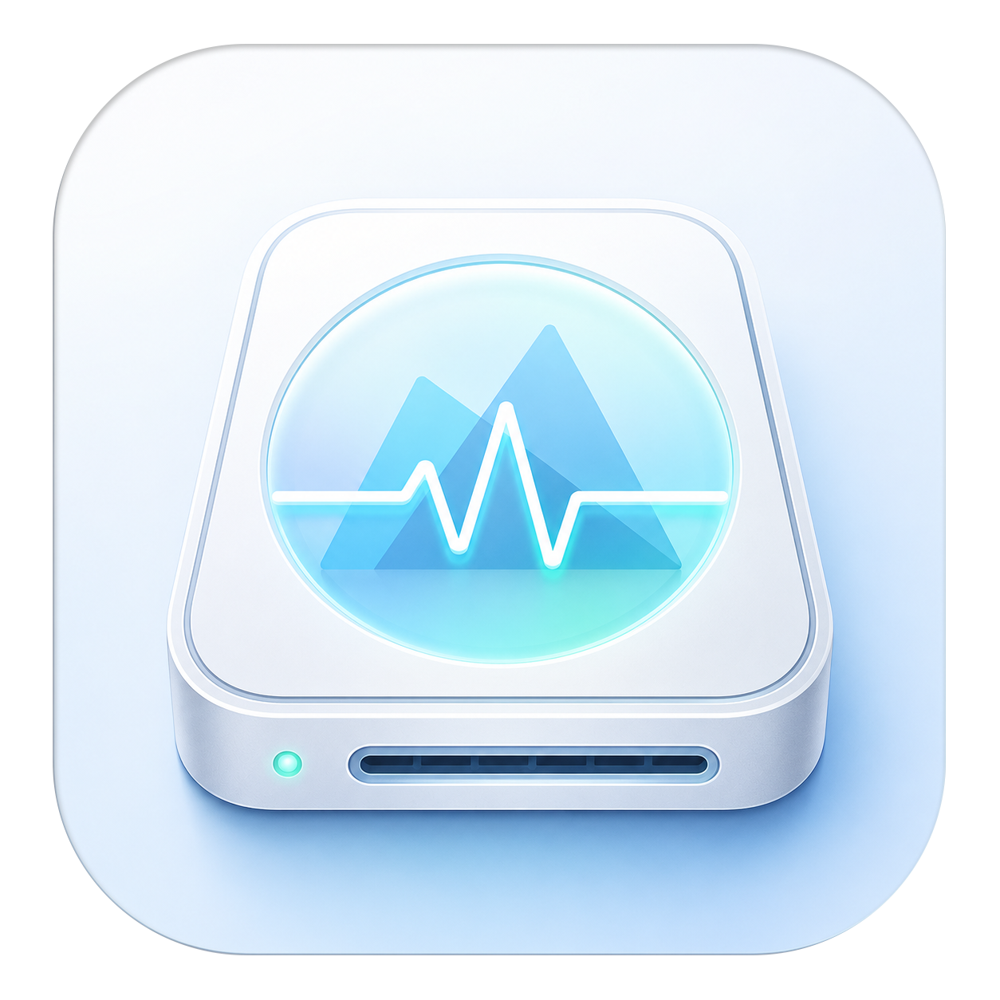

<p align="center">
  
</p>

<h1 align="center">MDriveHealth</h1>

<p align="center">
  Kiểm tra sức khoẻ ổ đĩa & hệ thống cho macOS — miễn phí, mã nguồn mở, cho cộng đồng Maclife 🇻🇳<br>
  <em>Drive & system health monitor for macOS — free and open source.</em>
</p>

---

## Tính năng / Features

| 🇻🇳 | 🇬🇧 |
|---|---|
| Đọc **SMART** ổ NVMe (kể cả SSD Apple / Apple Silicon) và SATA, không cần quyền root, không cần kext | Reads **SMART** from NVMe (including Apple SSDs on Apple Silicon) and SATA drives — no root, no kext |
| **Đánh giá sức khoẻ**: điểm 0–100 khi dữ liệu/mapping đủ; Unknown/partial khi chưa đủ; chỉ báo theo mức độ nghiêm trọng | **Health assessment**: 0–100 when data/mapping supports scoring; Unknown/partial otherwise; severity-ranked indicators |
| **SSD lifetime**, nhiệt độ, sector lỗi/pending, tổng dữ liệu đã ghi, giờ hoạt động… | **SSD lifetime**, temperature, reallocated/pending sectors, total bytes written, power-on hours… |
| Bảng **thuộc tính SMART đầy đủ** với tên/cách decode theo từng model ổ (database 589 dòng ổ từ smartmontools) | Full **SMART attribute table** with per-model names/decoding (589-entry database from smartmontools) |
| **Lịch sử & biểu đồ** (SQLite + Swift Charts): nhiệt độ, điểm, wear theo thời gian | **History & charts** (SQLite + Swift Charts): temperature, score, wear over time |
| **Theo dõi nền + cảnh báo**: icon menu bar, thông báo khi sức khoẻ giảm / có sector lỗi mới / quá nhiệt | **Background monitoring + alerts**: menu bar icon, notifications on degradation / new defects / over-temp |
| **Self-test** ngắn & mở rộng cho ổ SATA (kèm lịch sử kết quả, tự theo dõi tiến độ); quét kernel log tìm lỗi I/O | Short & extended **self-tests** for SATA drives (with result history & auto progress); kernel-log I/O error scan |
| **Đo tốc độ** đọc/ghi (tuần tự + Random 4K, QD1/QD8, bypass cache) kèm lịch sử, so sánh & **xuất ảnh chia sẻ** | **Speed benchmark** (sequential + Random 4K, QD1/QD8, cache-bypassing) with history, comparison & **shareable image export** |
| **Kiểm tra dữ liệu trên dung lượng trống** kiểu H2testw — báo phạm vi xác minh và dữ liệu hỏng; cần sao lưu trước | **Free-space data verification** (H2testw-style) — reports tested scope and corruption; back up before testing |
| **Cầu nối USB**: chip, tốc độ link thực tế, UASP; **TRIM status**; nút **Đẩy an toàn** chỉ ra app đang giữ ổ | **USB bridge** details (chip, negotiated speed, UASP); **TRIM status**; **safe-eject** that names blocking apps |
| **Dung lượng volume** trên từng ổ; ước tính **GB ghi/ngày** và dự phóng ngày cạn tuổi thọ SSD | Per-drive **volume usage**; **writes/day** estimate and SSD lifetime exhaustion projection |
| **Xuất báo cáo text** (copy/lưu file) để đăng lên group khi cần trợ giúp | **Text report export** (copy/save) for sharing when asking for help |
| **System Health**: pin (chu kỳ, % sức khoẻ), ~40 cảm biến nhiệt Apple Silicon, RAM/swap/áp lực bộ nhớ | **System Health**: battery (cycles, health %), ~40 Apple Silicon thermal sensors, RAM/swap/memory pressure |
| Giao diện tiếng Việt + English | Vietnamese + English UI |
| **Cập nhật qua Sparkle**: kiểm tra mỗi ngày, tải/cài có chữ ký; tùy chọn tự cài khi thoát app | **Sparkle updates**: daily checks, signed download/installation, optional automatic installation on quit |

## An toàn ghi thử / Write test safety

Kiểm tra dữ liệu chỉ xác minh phần thực sự đã ghi và đọc lại, không chứng nhận toàn bộ dung lượng hoặc suy ra NAND thật từ vị trí lỗi đầu tiên. Ổ có firmware khai khống có thể làm hỏng dữ liệu cũ dù ứng dụng chỉ tạo file trong chỗ trống. Chỉ dùng volume đã sao lưu hoặc ổ trống có thể xóa bỏ. App yêu cầu xem lại trước khi bắt đầu; APFS dùng chung dung lượng cần xác nhận riêng. Fill test trên volume khởi động bị chặn.

The result covers only the written and verified test range. It does not certify total capacity or identify physical NAND size from the first mismatch. Fraudulent firmware may corrupt existing data even when writing only to free space. Use backed-up or empty disposable volumes. The app requires a review before writing; shared APFS capacity requires additional confirmation. Startup-volume fill tests are disabled.

CLI requires explicit acknowledgement; use an external volume you can safely test:

```bash
mdrivehealth-cli verify-capacity /Volumes/Test --acknowledge-data-risk --max 1g
# Shared APFS capacity additionally requires --acknowledge-shared-capacity-risk.
```

## Cài đặt / Install

Tải file `.dmg` mới nhất từ [Releases](https://github.com/maclifevn/MDriveHealth/releases), mở và kéo **MDriveHealth** vào **Applications**.

Workspace hiện chưa có bản phát hành được nghiệm thu với Developer ID/notarization. Chỉ phân phối sau khi các gate phát hành trong [RELEASE.md](RELEASE.md) đạt yêu cầu. / Developer ID signing and notarization have not yet been accepted for this workspace; see the release gates in [RELEASE.md](RELEASE.md).

Onboarding và Settings dùng chung trạng thái login item. Công tắc là yêu cầu đăng ký; chỉ trạng thái được macOS cho phép mới đủ điều kiện tự chạy. Nếu còn chờ cấp phép, app hiện đường dẫn Mục đăng nhập trong Cài đặt hệ thống; khi quay lại app, trạng thái được đọc lại. Lỗi đăng ký/gỡ đăng ký hiện rõ, không tự đổi thành thành công. Phép đổi đã nhận vẫn được theo dõi khi đóng cửa sổ, và normal quit chờ completion. Chưa nghiệm thu đăng ký/đăng nhập thật trên bản ký cuối. / Onboarding and Settings share login-item state. The switch represents a registration request; macOS approval is required for eligibility to launch. Pending approval shows a Login Items action, and returning to the app refreshes status. Failed changes remain visible. Accepted changes stay tracked after closing a view, and normal quit waits for completion. Real registration/login acceptance on the final signed build is still pending. See [Apple ServiceManagement](https://developer.apple.com/documentation/servicemanagement/smappservice).

## Build từ mã nguồn / Build from source

```bash
brew install xcodegen
git clone https://github.com/maclifevn/MDriveHealth.git
cd MDriveHealth
xcodegen generate
xcodebuild -project MDriveHealth.xcodeproj -scheme MDriveHealth -configuration Release build
```

CLI (debug/verify): `cd Packages/MDriveHealthCore && swift run mdrivehealth-cli`

Version/build lấy từ `Config/Version.xcconfig`. Quy trình đóng gói dùng toolchain được pin, chạy test và kèm giấy phép cùng ZIP mã nguồn tương ứng có checksum; hướng dẫn tại [RELEASE.md](RELEASE.md). / Release packaging uses the pinned toolchain, runs tests, and includes licenses and a checksummed corresponding-source ZIP.

Build app nhúng `MDriveHealthWorker` cùng resource của core. Discovery, SMART, self-test và thông tin hệ thống chạy trong helper riêng; CLI dùng cùng protocol qua child của chính executable. Không phân phối app thiếu helper/resource. / The app build embeds `MDriveHealthWorker` and core resources. Hardware reads and self-test commands run in a separate helper; the CLI uses the same protocol through a child of its own executable.

Coordinator và khóa theo thiết bị ngăn các thao tác của MDriveHealth chồng nhau; refresh cập nhật từng ổ, tối đa ba worker. Benchmark/capacity của app và CLI chạy toàn engine trong child riêng, giữ khóa tới actual exit. Supervisor chỉ gia hạn idle deadline khi bytes/phase I/O hợp lệ tiến thêm; idle 30 giây, hard deadline 7 ngày, yêu cầu TERM rồi KILL sau tối đa 10 giây. Guardian trong child cũng xử lý parent chết. Không xác nhận child thoát thì giữ lease; không có receipt cleanup thì báo lỗi kèm UUID workspace, không báo đã dọn xong. Không cam kết kernel luôn hoàn tất SIGKILL đúng deadline. Quit/relaunch bình thường chặn thao tác mới, chờ worker/cleanup và tác vụ nền, thử lưu kết quả rồi đóng SQLite; instance mới chỉ được mở sau đó. Nếu kết quả chưa lưu hoặc cleanup chưa được xác nhận, app giữ mở và báo lỗi. App có recovery UI cho vị trí ghi hiện tại; durable job/result qua crash vẫn còn mở. / App and CLI measurements run in supervised children. Verified I/O progress controls the 30-second idle deadline, with a seven-day hard limit and up to ten seconds for cooperative cancellation before KILL. A child guardian handles parent death. Unconfirmed exit retains ownership, and missing cleanup receipts remain visible errors. Normal quit/relaunch stops new work, waits for measurement cleanup and background tasks, retries saving, and closes SQLite before opening another instance. Unsaved results or unconfirmed cleanup keep the app open with an error. Recovery UI covers the current write location; durable job/result recovery across crashes remains unfinished.

Theo dõi tắt thì app không xin quyền hoặc tạo cảnh báo tự động, kể cả khi mở lại cửa sổ hay refresh thủ công. Khi bật, mọi refresh hoàn tất đều đánh giá cảnh báo từ reading mới: không lỗi/stale/sleeping/probing, timestamp khớp reading, thuộc phiên đang bật và không quá hai phút. Ổ nóng hoặc đã hỏng ở lần đọc hợp lệ đầu tiên vẫn được báo; quá nhiệt chỉ báo lại sau khi hạ rồi vượt ngưỡng, hoặc có reading mới sau đổi ngưỡng/bật lại monitoring. Background poll bỏ qua cả SMART và đọc dung lượng filesystem khi HDD được registry báo đang ngủ; power state không đọc được vẫn là best effort.

Disabled monitoring does not request permission or create automatic alerts, including window reopen and manual refresh. Completed refreshes evaluate fresh readings captured during the enabled session and no more than two minutes old. Failed, stale, sleeping or unfinished readings cannot create events. A hot or failing drive can alert on the first valid reading. Temperature alerts repeat after cooling then reheating, or after a new reading following a threshold change or re-enabling monitoring. Background polling skips both SMART and filesystem capacity reads for rotational drives reported asleep by the registry.

Settings hiển thị quyền thông báo denied và lỗi xin quyền/gửi, kèm thử lại. Cảnh báo sức khỏe/nhiệt độ gửi lỗi giữ ID trong phiên; thời điểm backup reminder chỉ lưu sau khi hệ thống chấp nhận request. Self-test có outbox bền vững riêng, mô tả bên dưới. Tắt monitoring xóa cảnh báo chưa gửi của phiên và suppress thông báo self-test chưa gửi. / Settings shows denied permission and authorization/delivery errors with retry. Failed health and temperature alerts retain their IDs within the session; backup reminder timestamps advance only after system acceptance. Self-test uses a separate durable outbox described below. Disabling monitoring clears session alerts and suppresses unsent self-test notifications.

## Lịch sử và phục hồi / History and recovery

Lịch sử gắn với serial từ SMART/discovery hoặc media UUID khi có thể xác minh. Ổ thiếu định danh hoặc trùng serial được tách theo phiên; app hiển thị giới hạn này và không tự ghép lịch sử qua reboot/cắm lại. / History uses SMART/discovery serials or media UUIDs where available. Missing or duplicate identities stay separate within the session, with a visible limitation.

Database nằm trong `~/Library/Application Support/MDriveHealth/history.db`. Trước migration, app tạo bản sao SQLite nhất quán cạnh DB, tên `history.db.migration-<UUID>.backup`. Migration chạy trong transaction; lỗi phải hiện trên UI. Dữ liệu cũ được giữ riêng vì cách định danh và diễn giải chỉ số đã thay đổi, không dùng trong biểu đồ/cảnh báo mới. / Before a transactional migration, the app saves a consistent SQLite backup beside the database. Legacy rows remain separate from new charts and alerts because identity and metric semantics changed.

Schema 4 thêm journal/outbox cho self-test, migration từ schema 3 giữ dữ liệu cũ. App lưu run UUID và intent trước khi gửi lệnh, ACK sau khi firmware chấp nhận; kiểm tra lại identity, khả năng self-test, status và log dưới cùng khóa OS. Run được khôi phục sau restart, kể cả khi log lỗi hoặc ổ ngủ. App dùng physical slot/log mới để nhận diện completion, không chỉ so terminal byte. Test ngắn hoàn tất giữa hai poll và các lần pass/fail liên tiếp vẫn có event riêng. Không đọc được log là unavailable, không phải lịch sử rỗng hoặc đạt. Ổ thiếu/trùng identity bền vững không được khởi động self-test qua app. / Schema 4 preserves schema 3 data and adds the self-test ledger/outbox. The app persists a run UUID and intent before dispatch, then acceptance after ACK. Identity, capability, status and log are revalidated under the same OS lock. Runs restore after restart even when logs are unavailable or the drive is asleep. Physical log slots identify results completed between polls and consecutive identical outcomes. Unavailable logs do not become empty history or a pass. Starting a test requires a unique persistent drive identity.

App theo dõi self-test mỗi 30 giây khi có run, kể cả khi tab đóng; HDD báo ngủ không bị đánh thức bởi poll nền. Lỗi chưa gửi lệnh được tách khỏi lỗi chưa xác nhận ACK; app không tự gửi lại lệnh. Nếu firmware đã terminal nhưng không có đủ bằng chứng log, người dùng có thể đóng theo dõi với outcome chưa xác định; thao tác này kiểm tra trạng thái mới, không hủy firmware hoặc suy ra pass. Kết quả ghi nhận gần nhất và lỗi tracking hiện trong tab, được khôi phục từ SQLite. / Active runs are polled every 30 seconds independently of the tab, while background reads preserve reported HDD sleep. Not-issued failures are distinguished from unconfirmed ACKs; commands are never automatically resent. Explicitly closing tracking requires a fresh terminal status and records an indeterminate outcome without cancelling firmware or claiming a pass. The latest recorded result and tracking errors appear in the tab.

Completion và baseline commit trong một transaction. Thông báo dùng ID event cố định, persist sending trước SDK và đối chiếu pending/delivered request IDs sau restart. Khi không đủ bằng chứng thông báo đã hiển thị, app giữ uncertain và không tự resend; Settings cho phép bỏ qua thông báo chưa xác nhận, kết quả vẫn còn. SQLite và Notification Center không có transaction chung: đây không phải cam kết exactly-once banner, và SDK acceptance không chứng minh người dùng đã thấy thông báo. Implementation/tests local F11 đã nối đầy đủ, nhưng gate ATA/HDD/USB thật, UI/native notification, Intel/macOS minimum và vận hành dài còn mở. / State and completion commit atomically. Notifications use stable event IDs, persist claims before SDK submission and reconcile system request IDs after restart. Missing evidence becomes uncertain without automatic resubmission; Settings can dismiss unconfirmed notifications while retaining results. SQLite and Notification Center have no shared transaction, so exactly-once banners and user visibility are not guaranteed. F11 is integrated and tested locally; real ATA/HDD/USB, native UI/notification, Intel/minimum-OS and long-running acceptance gates remain open.


Kết quả benchmark và capacity chưa lưu vẫn giữ qua Reset, có lỗi và nút thử lưu lại. Quit/relaunch chờ cả hai hàng đợi lưu và giữ app mở nếu history còn lỗi. Worker production ghi intent trước I/O và terminal trước result IPC; app lưu theo UUID transaction trước khi dọn journal. Nếu metadata journal lỗi, kết quả đã hoàn tất vẫn được trả lại để giữ trong RAM/thử lưu SQLite; chưa coi RAM là durable. App đã nối startup recovery và danh sách lịch sử/phục hồi global; nghiệm thu restart app production thật còn mở. / Unsaved benchmark and capacity results survive Reset and have a retry action. Normal quit/relaunch drains both queues and stays open on history failure. Production workers persist intent before data I/O and terminal before result IPC; the app commits by UUID before consuming the journal. Metadata failures preserve the known completed result in memory for a history retry. Startup recovery and global history/recovery UI are integrated; actual production-app restart acceptance remains open.

Phiên benchmark/capacity mới có workspace riêng `.com.maclife.mdrivehealth.test-<UUID>` và manifest `ownership-v1.ndjson`. Ownership gồm volume UUID, inode/owner/birth time của directory, manifest và từng file; bản ghi được `fsync` trước khi engine nhận descriptor để ghi dữ liệu. Filesystem phải giữ được quyền riêng 0700/0600 và identity này; không kiểm chứng được thì dừng trước khi ghi dữ liệu test. FAT/exFAT chưa được nghiệm thu và không được mặc định coi là hỗ trợ. Manifest dùng tối đa 131.072 file và 64 MiB; capacity range vượt giới hạn file bị từ chối trước khi ghi, không tự giảm range rồi báo pass. / New measurement workspaces persist file ownership before handing writable descriptors to the engine. Private permissions and stable identities are required. Unsupported ownership fails before measurement data writes. FAT/exFAT compatibility is unverified. The bounded manifest rejects excessive file counts without silently shortening the requested range.

App tự quét chỉ đọc sau khi discovery xác minh volume, hiện banner và danh sách file test còn sót; có thể quét lại từng volume. Ổ ngủ/stale được hoãn, ổ offline giữ thông tin lần quét trước và không cho cleanup. CLI cũng kiểm tra tại vị trí ghi hiện tại, qua helper có deadline. Boot volume chỉ dùng temp directory hiện tại; không quét toàn bộ ổ hoặc tự tìm các temp path tùy chỉnh cũ. Cleanup cần xác nhận riêng cho một workspace, rồi kiểm tra lại volume, thư mục cha, manifest/proof và mọi inode dưới khóa; không xóa đệ quy. File lạ, symlink/hard link, replacement, manifest thiếu/hỏng và legacy được giữ nguyên. Cảnh báo UUID của phiên chỉ được gỡ sau scan đầy đủ đúng persistent volume UUID, identity thư mục cha và nguồn ổ vật lý; serial phải duy nhất, hoặc phải đúng attachment trong cùng boot session nếu không có serial đáng tin. Scan lỗi/partial, candidate chưa xác minh hoặc thư mục mới tại cùng đường dẫn không chứng minh cleanup đã xong. App phục hồi review từ journal khi mở lại, cùng lịch sử benchmark/capacity theo UUID kể cả ổ đã tháo; hồ sơ không xác minh được được giữ lại. Các gate phần cứng/runtime của F15 vẫn mở. / The app scans verified current write locations without deleting files, provides a recovery banner/list and supports rescans. Sleeping/stale volumes are deferred; offline results remain stale and cannot authorize cleanup. The CLI uses the same supervised helper. Boot recovery covers only the current temporary directory. Explicit cleanup revalidates the volume, parent directory, proof and file identities under the volume lock; unknown or legacy contents are preserved. Run warnings clear only after a complete scan of the correct persistent volume, parent inode/owner/birth time and physical drive origin. A unique serial permits reattachment; without one, only the exact attachment within the same OS boot session can resolve the warning. Partial/error scans and replacement directories at the same path cannot prove cleanup. Startup recovery restores journal-backed reviews and UUID benchmark/capacity history even for disconnected drives; unverified records are preserved. F15 hardware/runtime gates remain open.

```bash
swift run --package-path Packages/MDriveHealthCore mdrivehealth-cli workspaces / --json
# Use a mounted volume path or volume BSD name; copy name/proof from that scan.
swift run --package-path Packages/MDriveHealthCore mdrivehealth-cli workspaces / --cleanup '<workspace-name>' --proof '<proof>'
```

Các fixture SIGKILL dùng file nhỏ trong directory tạm, kiểm tra trước/sau journal, sau ghi và khi cleanup đã xóa một phần. Đây không phải thử mất điện hoặc unplug thiết bị thật. Đồng bộ ownership không bảo đảm phần cứng đã giữ metadata sau mất điện; xem [Apple fsync](https://developer.apple.com/library/archive/documentation/System/Conceptual/ManPages_iPhoneOS/man2/fsync.2.html). / SIGKILL fixtures cover interrupted ownership/data writes and partial cleanup using small disposable files. They do not certify power-loss, unplug or external-filesystem recovery.

Journal đã nối vào worker/app/CLI: protocol measurement 3 yêu cầu ticket và delegated job FD 5; receipt gắn đúng immutable record/result. Job còn active tới actual child exit, kể cả parent chết. JSON không canonical hoặc có field lạ được giữ để kiểm tra. Intent format 2 lưu lựa chọn history; `--no-record` bỏ SQLite, chỉ dọn metadata sau completed result + cleanup xác nhận, không tự archive về sau. History schema 5 lưu cả benchmark và capacity theo UUID. Kết quả đã lưu nhưng GC metadata lỗi có cảnh báo riêng. App quét/promote/import journal bằng tác vụ được theo dõi, phục hồi kết quả hoặc phiên gián đoạn theo đúng UUID/intent và chờ các tác vụ này trước khi đóng SQL. Lịch sử global phân trang 100 hồ sơ gồm cả capacity và ổ offline. Phiên omit không tự nhập lịch sử; chỉ bỏ hồ sơ hoàn tất đã xác nhận cleanup sau xác nhận trên UI. Nếu journal lẫn SQLite cùng lỗi, kết quả vẫn có thể chỉ còn trong RAM và normal quit bị chặn để thử lưu lại. Gate restart app thật, power loss/disconnect, kernel stall, ký phát hành, phần cứng và UX còn mở; chưa production-ready. / Measurement protocol 3 delegates the job FD and binds results to a durable receipt. Ownership survives parent death until actual child exit. Foreign or noncanonical JSON stays unverified. Intent format 2 records history policy; `--no-record` skips SQLite and consumes only a completed, cleaned journal after output. Schema-5 history archives both result types by UUID. Metadata-GC failures retain a separate warning. Tracked startup recovery promotes intact staged terminals, reconciles the exact UUID/intent with SQL and drains before SQL close. Global history pages contain 100 records, including capacity and offline drives. Omitted runs never auto-import and require confirmation to discard a completed, cleaned recovery record. If journal and SQL both fail, the result may still exist only in RAM; normal quit blocks for retry. Actual production restart, power loss/disconnect, kernel stall, signed release, hardware and UX gates remain open.

## Chạy kiểm tra / Run checks

```bash
swift test --package-path Packages/MDriveHealthCore
xcodegen generate
xcodebuild -project MDriveHealth.xcodeproj -scheme MDriveHealth -destination 'platform=macOS' CODE_SIGNING_ALLOWED=NO test
```

Các test model dùng source thực của store, coordinator, benchmark/capacity runner, monitoring và services với provider/engine/notification giả lập, không launch app để ghi thiết bị hoặc gửi thông báo thật. Core tests có process thật, protocol helper, khóa giữa process và đọc metadata hệ thống; có các phép ghi nhỏ trong workspace tạm, không gửi lệnh firmware self-test hoặc eject. Trạng thái mọi F01–F24 và bằng chứng từng nhóm nằm trong [audit/FIX_PROGRESS.md](audit/FIX_PROGRESS.md). / Model tests compile actual app sources with deterministic hardware, engine and notification providers. Core tests exercise real processes, helper IPC and command locks, including small writes in disposable test workspaces. They do not start firmware self-tests or eject hardware. See the audit progress for all outstanding release gates.

## Kiến trúc / Architecture

```
Packages/MDriveHealthCore   # engine: IOKit discovery, NVMe/ATA SMART, drivedb,
                            # scoring, history, system health
├── CSMART (C)              # NVMeSMARTLib (private) + ATASMARTLib (public) bridge
App/                        # SwiftUI app: dashboard, charts, menu bar, alerts
tools/convert_drivedb.py    # smartmontools drivedb.h → drivedb.json
scripts/release.sh          # archive → sign → notarize → DMG
```

- NVMe: plugin IOKit `NVMeSMARTLib` (interface được smartmontools dùng ổn định nhiều năm, hoạt động với SSD Apple Fabric trên Apple Silicon).
- SATA: API công khai `ATASMARTLib`.
- Điểm số chỉ có khi các chỉ số được hỗ trợ đủ để đánh giá; mapping ATA phụ thuộc model/vendor và loại media. Dữ liệu thiếu hoặc mapping chưa đáng tin được giữ là Unknown/partial, không mặc định 100 điểm. / Scores require sufficient supported metrics; ATA interpretation depends on the model/vendor and medium. Missing data or uncertain mappings stay Unknown/partial.

## Giới hạn đã biết / Known limitations

- **SMART qua ổ ngoài**: khả năng đọc phụ thuộc thiết bị, cầu nối, driver và interface mà MDriveHealth truy cập được. Không cam kết mọi ổ USB/Thunderbolt/NVMe đều hỗ trợ. Không đọc được hoặc dữ liệu thiếu được hiển thị là unavailable/Unknown, không suy ra ổ tốt hay hỏng. / External-drive SMART depends on the device, bridge, driver and accessible interface. USB, Thunderbolt and NVMe support is not universal. Unavailable or incomplete data does not prove health or failure.
- **NVMe self-test**: MDriveHealth chưa triển khai firmware self-test cho NVMe. / MDriveHealth does not currently implement NVMe firmware self-tests.

## Giấy phép / License

[GPL-3.0-or-later](LICENSE). Attribute database chuyển đổi từ [smartmontools](https://www.smartmontools.org) `drivedb.h` (GPL-2.0-or-later) — cảm ơn dự án smartmontools! Icon và toàn bộ code còn lại © cộng đồng Maclife.
